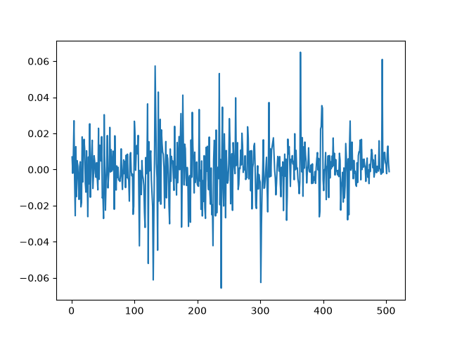
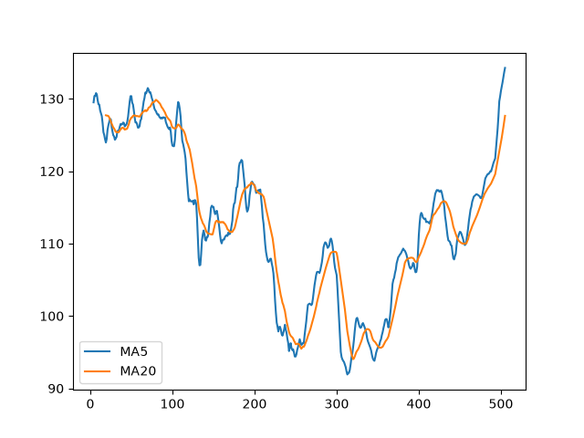

# 苹果公司(AAPL)股票数据分析与量化策略可视化

## 项目简介
本项目使用 Python 对真实的苹果公司历史股票数据进行了处理、分析与量化策略可视化。这是我独立完成的第一个数据分析项目。

## 技术栈
- Python 3.12
- Pandas
- Matplotlib

## 实现功能
1. 读取真实的股票 CSV 数据。
2. 清理数据中的缺失值 (`dropna`)。
3. 计算每日收益率 (`pct_change`)。
4. 计算5日均线(MA5)与20日均线(MA20)，实现双均线交叉策略 (`rolling`, `mean`)。

## 项目成果图

### 1. 日收益率波动图

### 2. 双均线策略图 (MA5 vs MA20)

## 作者
Ruantong Li (Financial Engineering Undergraduate)
